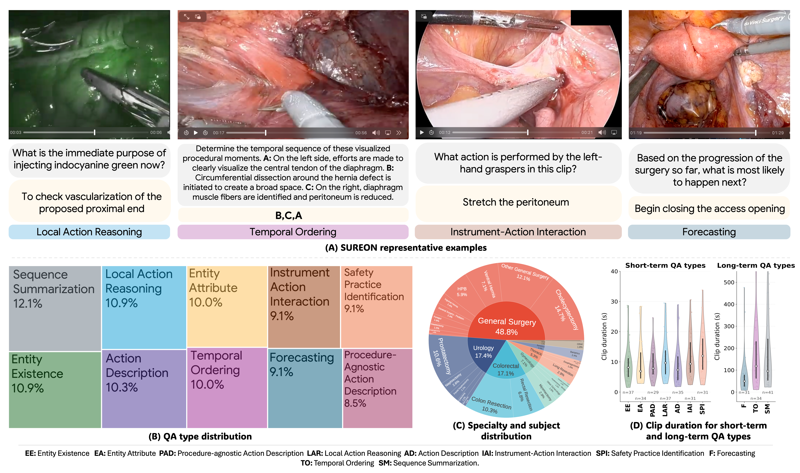
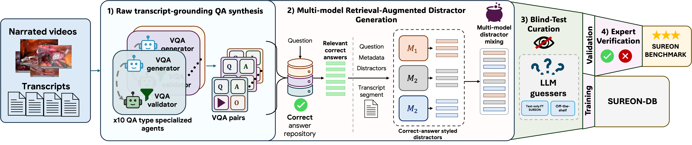

<div align="center">

# SUREON
### A Benchmark and Vision-Language Model for Surgical Reasoning

**WACV 2027**

Alejandra Perez<sup>1,&#42;</sup>, Anita Rau<sup>1,&#42;</sup>, Busisiwe Mlambo<sup>1</sup>, Lee White<sup>1</sup>, Aina Brunet<sup>2</sup>,<br>
 Juan Verde<sup>3,4</sup>, Juan Caicedo<sup>5</sup>, Joël L. Lavanchy<sup>6,7</sup>, Adam Schmidt<sup>1</sup>,<br>
 Chinedu Nwoye<sup>1</sup>, Omid Mohareri<sup>1,†</sup>, Muhammad Abdullah Jamal<sup>1,†</sup>

<sub>&#42;,† Equal Contribution</sub>

<sub>
<sup>1</sup>Intuitive Surgical Inc., USA &ensp;·&ensp; <sup>2</sup>Hospital Universitari Bellvitge, Spain &ensp;·&ensp; <sup>3</sup>IHU Strasbourg, France<br>
<sup>4</sup>University of Strasbourg, CNRS, France &ensp;·&ensp; <sup>5</sup>Fundación Santa Fe de Bogotá, Colombia<br>
<sup>6</sup>University Digestive Health Care Center – Clarunis, Switzerland &ensp;·&ensp; <sup>7</sup>University of Basel, Switzerland
</sub>

[](https://arxiv.org/html/2603.06570v1)
[](https://huggingface.co/datasets/aleperez24/sureon)
[](https://aperezr20.github.io/sureon/)


SUREON is a surgical video question-answering dataset spanning perception and reasoning beyond traditional classification taxonomies.

</div>



During construction, blind testing checks challenge language shortcuts and guide curation. The release includes training/validation annotations and 340 surgeon-verified test questions: **299 accuracy questions** and **41 summaries**, scored separately.



## Quickstart

1. Follow [setup](docs/setup.md) for the default Transformers environment.
2. In `config.yaml`, set your video directory and blurring-model directory.
3. Download curation models `best_fold0.pt` through `best_fold4.pt` from [here](https://huggingface.co/visurg/LEMON_curation_models/tree/main/nonsurgical_object_detection) ([1](#lemon-reference)). These models along OCR detection will blur text present in the surgical scene.

Run from this directory:

```bash
python scripts/download_dataset.py --split test
python scripts/download_videos.py --split test
python scripts/preblur.py --split test --accuracy-only
python scripts/evaluate.py --mode both --accuracy-only
```

This evaluates Qwen3-VL-8B with and without video. Results are saved under `results/`.

Use `--split all` on both download commands for train + validation + test. Run all scripts from this directory. Videos are stored as `videos/SOURCE_VIDEO_ID/SOURCE_VIDEO_ID.mp4` and retain their source terms. For authenticated YouTube downloads, add `videos.cookies_file` to your [config](config.yaml). See the [SurgLaVi download instructions](https://github.com/aperezr20/SurgLaVi#1-surglavi-dataset) for details on obtaining YouTube cookies.

## Examples and options

- [Load the dataset and a Qwen3-VL training sample](docs/loading.md)
- [Validation, summary judging, and server inference](docs/evaluation.md)

Training/validation are automatically pseudo-labeled. Select `passes_blind_curation == true` for the paper's curated subsets.

## Paper-reported results

Accuracy (%) on the 299-question test subset; summaries are excluded. These are reported values from Table 3 of the current paper, not new measurements from this repository. Gains are transcribed as reported and may differ slightly from subtraction of rounded accuracies.

| Model | With video | Without video | Multimodal Gain |
|---|---:|---:|---:|
| Human | 64.9 | — | — |
| **SUREON-VLM** | **48.2** | **19.1** | **29.1** |
| Gemini 3.1 Pro | 52.2 | 31.8 | 20.4 |
| GPT-5.1 (high) | 46.8 | 25.8 | 21.1 |
| Qwen3-VL-8B-Instruct | 23.1 | 13.4 | 9.7 |

## Citation

If you find **SUREON** useful for your research, please cite our work:

```bibtex
@article{perez2026sureon,
  title={SUREON: A Benchmark and Vision-Language Model for Surgical Reasoning},
  author={Perez, Alejandra and Rau, Anita and Mlambo, Busisiwe and White, Lee and
          Brunet, Aina and Verde, Juan and Caicedo, Juan and Lavanchy, Jo{\"e}l L. and
          Schmidt, Adam and Nwoye, Chinedu and Mohareri, Omid and Jamal, Muhammad Abdullah},
  journal={arXiv preprint arXiv:2603.06570},
  year={2026}
}
```


## License

This dataset is released under the [Creative Commons Attribution-NonCommercial-ShareAlike 4.0 International License (CC BY-NC-SA 4.0)](https://creativecommons.org/licenses/by-nc-sa/4.0/).


## References

<a id="lemon-reference"></a>

[1] C. Che, C. Wang, T. Vercauteren, S. Tsoka, and L. C. Garcia-Peraza-Herrera, “Lemon: A large endoscopic monocular dataset and foundation model for perception in surgical settings,” in *Proceedings of the IEEE/CVF Conference on Computer Vision and Pattern Recognition*, 2026, pp. 42659–42669.
